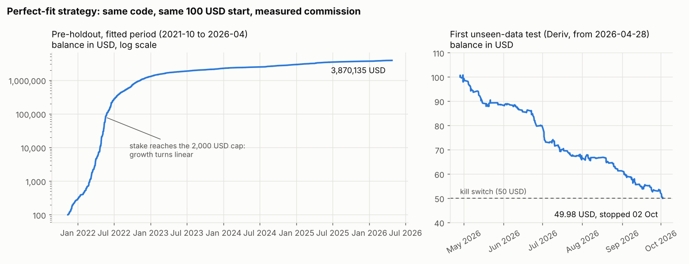

# Perfect-fit experiment: fitted results vs the first unseen-data test

Branch `experiment/perfect-fit` only, not merged to main. 31 Oct 2026.

**In one sentence:** the best strategy that could be fitted to the 4.5 years before
the holdout turned 100 USD into 3.87 million USD on those years, then lost half of
100 USD on the six months it had never seen. The kill switch stopped it on 2 Oct 2026.

## The two results side by side

Both runs used the same code and the same saved model, started with 100 USD, and
paid commission from `cost_by_hour.json` at each trade's opening hour plus the
slippage rules. Every hard limit applied, and the kill switch was enforced as the live bot would.

| | Pre-holdout (fitted) | **First unseen-data test** |
|---|---|---|
| Data | Dukascopy 1m, 2021-10-27 to 2026-04-27 | Deriv 1m, 2026-04-28 to 2026-10-30 |
| Did the strategy see this data while being built? | Yes, all of it | No, never |
| Trades | 5,533 | 386 (stopped early) |
| Net profit | **+3,870,034.70 USD** (+3,870,035%) | **−50.02 USD (−50.0%)** |
| Final balance | 3,870,134.70 USD | 49.98 USD |
| Max drawdown | 1.29% | 50.41% |
| Net profit / max drawdown | 2,995,147 | −0.99 |
| Win rate | 97.8% | 33.9% |
| Average win / average loss | +728.70 / −576.70 USD | +0.29 / −0.35 USD |
| Profit factor | 55.1 | 0.43 |
| Kill switch | never | **fired 2 Oct 2026 11:24 UTC** |
| Months in profit | 54 of 54 | 0 of 7 (lost money in every month) |
| At 1.5x commission | +3,604,116 USD, drawdown 1.44% | −50.02 USD, kill switch after 277 trades |
| MT5 micro costs (comparison only) | +4,236,086 USD | −19.57 USD (no kill switch) |

Average win and loss are in USD, so they grow with the balance. On the fitted
period the stake reached the risk module's 2,000 USD maximum on 17 May 2022. After
that, growth is linear rather than compounding (the bend in the left chart).

Losses on the unseen data by pair: EUR/USD −11.18 USD (98 trades), GBP/USD −18.18
(139), USD/JPY −20.66 (149). All three pairs lost. By month: Apr −1.60, May −9.75,
Jun −8.72, Jul −13.17, Aug −5.47, Sep −9.13, Oct −2.18 (to the 2nd).

Full reports (trades, metrics, Monte Carlo drawdowns, per-run charts):
- fitted: [`reports/backtests/experiment_perfect_fit_preholdout/`](backtests/experiment_perfect_fit_preholdout/report.md)
- unseen: [`reports/backtests/experiment_perfect_fit_first_unseen_test_HOLDOUT/`](backtests/experiment_perfect_fit_first_unseen_test_HOLDOUT/report.md)

## The strategy, in plain language

Code: `src/fxbot/strategies/perfect_fit.py` (class `PerfectFit`) with the features in
`src/fxbot/strategies/pf_features.py` and the saved model in `models/perfect_fit/`.
The live bot can run it like any other strategy, and every order still passes the risk module.

1. Once an hour, when a 1h candle closes, look at each pair. Only at
   06:00-17:00 UTC, and never at 12:00 (or 13:00 on EUR/USD), because Deriv's
   commission there is above the cost gate.
2. Describe the market right now with 43 numbers, all from closed candles. They
   cover recent moves over 1 hour to 5 days, where price sits in its recent range,
   distance from moving averages, volatility, RSI, the last candle's shape, today's
   and yesterday's move, the other two pairs' recent moves, the hour and the weekday.
3. Find the **single most similar hour** in a memory of 37,023 past hours
   (2021-10 to 2026-04, all three pairs). "Similar" means closest on those 43
   numbers after putting them on the same scale. This is a 1-nearest-neighbour model.
4. Look up what happened after that past hour: what an Up trade and a Down trade
   with the exit rules below actually made, after costs.
5. If the better of the two made more than **30% of its stake**, open that
   direction now. Otherwise do nothing.
6. Every trade: **x200**, stake 3% of balance, **stop loss 30 pips, take profit 30 pips**,
   and close after **1 hour** if neither is hit. The usual limits also apply:
   at most 2 open trades and 1 per pair, the 10% daily loss limit, the kill switch
   at 50%, x200 closed by 20:50 UTC, nothing held into the weekend.

### Why it looked perfect on the past and failed on new data

Step 3 explains both results. On the fitted period, the most similar past hour to
any hour is **that same hour**, because it is in the memory. So the strategy was
really looking up its own future and trading only when it already knew the trade
would win. That is why it shows a 97.8% win rate and a 1.29% drawdown. Its
"inputs" are only closed candles, but its memory was built from what happened next.

On new hours there is no exact match. The nearest past hour is just a different
day that looked a bit alike. What happened after it says almost nothing about what
happens next. The result was 33.9% winners and a loss on every pair and in every month.

This is called **overfitting**. A model with enough freedom can fit any past period
almost perfectly. In-sample numbers then measure how much the model can remember,
not whether it can trade. The research rules this experiment switched off
(walk-forward, the luck check, the parameter limit, 2-of-3 pairs) exist to catch this.

## How the winner was found

Full log: [`research/experiment_log.md`](../research/experiment_log.md). Every
variant is a row in `research/experiment/variants.csv.gz`.

- **299,152 variants** were tried on the pre-holdout period. Each one is a set of
  entry rules combined with one of 528 exit setups (x100 or x200, stop loss, take
  profit, time exit).
  - Rules: best direction per pair and hour (528 variants), one indicator above
    or below a threshold (247,104), two indicators together (50,844), and the
    best of those kept only in the pair/hour slots that made money (100).
  - Machine learning, fitted to the whole period: LightGBM at 3 sizes and
    nearest-neighbour models with 1, 5 and 25 neighbours, each on 16 exit setups at
    6 thresholds (576).
- A fast screen scored all of them. It reproduces the engine's fill rules within
  a cent per trade, and a test checks this. The 116 best were then re-run in the
  real backtest engine with every limit. The engine score decided the winner.
- Rules alone did badly. Of the one-indicator rules, 98% hit the kill switch. The
  best rule-based variant in the engine made +73.71 USD on 39 trades
  (score 16). Every ML model beat it by a factor of thousands, and the models
  with the most freedom to memorise scored highest.
- The ceiling, which is not a strategy: knowing the future at every candidate
  hour scores about 14.8 million on the screen. The winner's engine score of
  3.0 million comes from the same source.

The ML stage did not use calendar-date features (year, month, day number). A
model with those could only memorise dates and would have nothing to say about new ones.

## What was kept from the project rules, and what was dropped

Kept: commission by UTC hour from `research/phase2/cost_by_hour.json` (never the
medians in `config/contract_specs.yaml`), entry slippage 0.5 pip, stop loss 1 pip
past its level, Deriv's stop-out formula, the 3% stake, the 10% daily limit, the
kill switch, x100/x200 only, max 2 positions and 1 per pair, the cost gate, the
06:00-17:59 entry window, the daily pause, the Friday close, and closed candles only.

Dropped for this experiment only (owner's instruction): walk-forward validation,
the luck check, the 5-parameter limit, the 2-of-3-pairs rule, the train/validation split.

## How the unseen-data test was kept honest

- The model files were committed (commit `24d7434`) before the holdout was opened.
- `scripts/xp_holdout.py` saved a SHA-256 fingerprint of each model file before
  running. If the test has already run, it refuses to run again
  (`research/experiment/holdout_once.json`). It ran once, and nothing was changed afterwards.
- Candles from before 28 Apr 2026 were loaded only to warm up the indicators. No
  trade opened before 28 Apr, and the script checks this.
- The 1.5x-commission and MT5 columns come from the same single run of the same
  strategy. This is the standard report format; they were not extra attempts.

## What this means for the bot

- **This strategy must not be traded.** On data it had not seen, it lost money every month and hit the kill switch.
- In-sample results (net profit, drawdown, win rate on the period a strategy was
  built on) can be pushed as high as you like. They say nothing about the future.
  Only results on data the strategy never saw count. That is why the main research
  keeps walk-forward and the luck check, and why the holdout is used only once.
- The holdout has now been used once, for this experiment. On main, the holdout is
  still meant for a single final test of a strategy that passes the normal rules.
  Whether to collect fresh data from 31 Oct 2026 onward as a new untouched test
  period is a decision for the owner.
